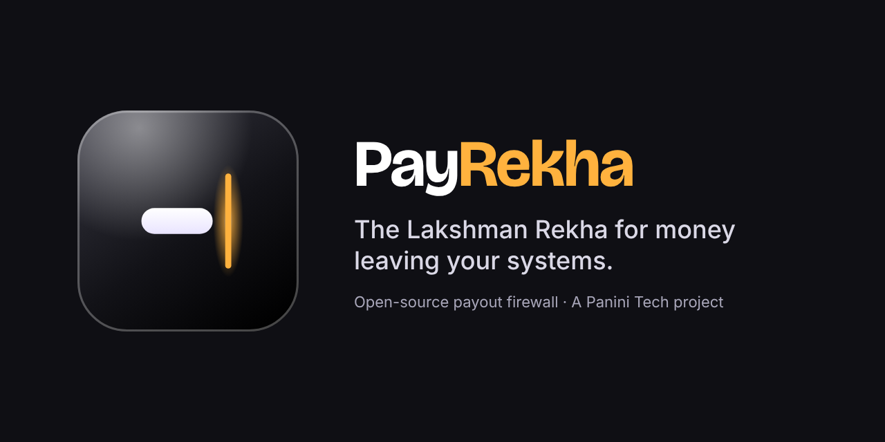
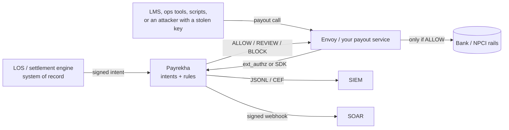

<p align="center">
  
</p>

# Payrekha

**The Lakshman Rekha for money leaving your systems.**
No matching intent, no payout — whoever is calling.

[](https://github.com/peopleofproduct/payrekha/actions/workflows/ci.yml)
[](LICENSE)
[](package.json)
[](CHANGELOG.md)
[](https://github.com/peopleofproduct)

## The name, and the line it stands for

In the Ramayana, when Lakshman has to leave Sita alone, he draws a line in the earth around her — the *Lakshman Rekha*. And here's the part that matters: **Ravana never broke that line. He couldn't.** He came disguised as someone harmless, and got Sita to step outside it.

Attackers work the same way. They don't break your payment rails — they show up dressed as your own systems: your API, your credentials, your app. Then they ask your money to step outside.

**Payrekha — *pay* + *rekha* — is the line that holds anyway.**

When your systems are present and honest, money moves freely: a sanctioned loan, a settled merchant, a whitelisted withdrawal. But when something is wrong — a stolen credential, a repackaged app, a payout call at 3 AM on a holiday — the line holds. Whoever is calling, whatever key they hold: **no matching intent, no payout.**

## What it does, in one breath

Payrekha is an open-source **payout firewall** for Indian NBFCs, digital lenders, payment aggregators and crypto exchanges. It sits between your payout API and the money rails and asks two questions of every rupee leaving:

1. **Was this payout actually decided?** Your system of record (LOS, reconciliation, withdrawal approver) signs an *intent* — this loan, this ceiling, this beneficiary, valid until this time. A payout must show a matching intent to pass.
2. **Does it look like the attacks we've seen?** ₹1-then-large probes, brand-new beneficiaries, holiday bursts, UAT keys in prod — the patterns in the CERT-In advisory.

Get either answer wrong and the money stays. Even if the attacker is inside, with your real payout credential, they still don't hold the intent-signing key — **the money doesn't leave.**

*Built against CERT-In Advisory CIAD-2026-0058 · open source · runs inside your walls · never phones home.*

## Why this week, of all weeks

CERT-In advisory **CIAD-2026-0058** ("CRAFTY FALCON") describes attackers who get inside a lender and call its *own* payout APIs with valid credentials — and it warns they favour **holidays**, when the guardians are thinnest.

This is Diwali week — the festival that celebrates the very epic the Lakshman Rekha comes from, and one of the longest low-staffing windows of the year. We open-sourced Payrekha the week the guardian steps away, because that's exactly when the line matters. The [weekend kit](docs/weekend-kit.md) stands it up in ~30 minutes in shadow mode — it watches, learns and alerts, and by construction **it cannot block a single payout.**

## How you adopt it — four steps, each reversible

| Step | When | What happens | What it can break |
|---|---|---|---|
| **Replay** | Day 1 · ~30 min | Your last month's payout export runs through it on a laptop — see what it would have caught | Nothing — it reads a file |
| **Shadow** | Week 1 | Sits in front of the payout API in observe-only mode | Nothing — it cannot block by construction |
| **Advise** | Week 2–3 | Your payout service reads each verdict; ops reviews the holds | Nothing — verdicts are advisory |
| **Enforce** | When you're ready | Turn it on per payout type, riskiest first (crypto withdrawals, merchant settlements) | Only what you explicitly turn on |

| | |
|---|---|
| **What it is** | A TypeScript library and a small HTTP gateway (with an Envoy ext_authz adapter) that answers `ALLOW`, `REVIEW` or `BLOCK` for each payout. Measured p99 is about 19 µs in-process and 0.7 ms through the gateway on a laptop. |
| **Who it's for** | Teams that run payout, disbursal, refund, settlement or withdrawal APIs, and the CISOs who answer for them. |
| **What it is not** | Not an ML platform, not an EDR, and not a replacement for patching or cloud audit logs. It is the last check before the money leaves. |
| **Maturity** | **Alpha** (`0.1.0-alpha.0`). Thresholds are illustrative and have not been tuned on production data. Run it in shadow mode first. |

## The attack it's built for

CERT-In advisory CIAD-2026-0058 describes "CRAFTY FALCON": attackers get inside a lender or payment company and then **call the victim's own payout APIs**. They do ₹1 test transfers before large ones. They abuse merchant settlement APIs. They move from an exposed UAT box into production, call APIs directly from repackaged mobile apps, and strike on holidays. Every one of those calls uses a valid credential. Perimeter controls do not see a problem.

Payrekha adds a second key. The system that *decides* money should move (your LOS, your reconciliation engine, your withdrawal approver) signs an **intent**: this loan, this amount ceiling, this beneficiary, valid until this time. The system that *moves* money must show a matching intent. If an attacker steals the payout credential, they still do not have the intent-signing key. **Even if they're inside, the money doesn't leave.**

## Where it sits



## See it work in 10 seconds

```bash
npm ci && npm run demo            # the CRAFTY FALCON chain against a fake NBFC
npm run demo -- --shadow          # the same run in shadow mode: nothing stopped, everything logged
npm run demo -- --json            # one JSON line per step
npm run demo:live                 # live, through Envoy (start the compose stack first)
```

The demo walks through these steps: a legitimate penny-drop and loan disbursal, then stolen credentials with no intent, a replayed intent, a ₹1 then ₹4,99,999 probe, a UAT key, a changed settlement account, a Diwali burst, and a canary hit that enters `HIGH_ALERT`. It ends with *"8 attack steps. ₹0 left the building."*

## Try it on your own data, with no integration

```bash
npm run replay -- --payouts examples/data/payouts.csv --intents examples/data/intents.csv --config examples/data/payrekha.json
npm run replay -- --payouts your-ledger-export.csv     # intent-less mode: Day 1, no production change
```

This writes a terminal summary, a self-contained `report.html` and `report.json`. See [getting started](docs/getting-started.md).

## Run it as a service in 30 seconds

```bash
docker compose -f deploy/docker-compose.yml up --build
# Envoy :10000 guards a fake /payouts API · Payrekha :8080 · Prometheus :9090
curl -i -XPOST localhost:10000/payouts -H 'x-payout-kind: LOAN_DISBURSAL' \
  -d '{"request_id":"r1","amount_in_paise":24000000,"beneficiary":{"account_number":"000123456789","ifsc":"HDFC0001234"}}'
# shadow (default): 200, and the BLOCK is logged · after PUT /v1/state {"mode":"enforce"}: 403 + x-payrekha-rules: intent.missing
```

## How a verdict is produced

1. **Shape check.** Malformed, missing or unparseable input becomes `REVIEW` with `degraded: true`. It is never a silent `ALLOW`.
2. **Retry dedupe.** The same `payoutId` gets the same answer.
3. **Rules in order.** Canaries and origin come first, then the intent binding, then behaviour. The first `BLOCK` short-circuits; otherwise the worst verdict wins. A rule that throws is isolated in `ruleErrors` and the verdict is marked degraded.
4. **Mode.** `shadow` (default) always lets the payout through and logs. `advise` tells the caller. `enforce` holds or declines. The mode can be set per payout kind.
5. **Alert state.** `NORMAL` changes to `HOLIDAY` automatically from the calendar, which tightens thresholds. A canary hit or a burst of blocks raises `HIGH_ALERT`, and every payout then needs an intent. **HIGH_ALERT never expires on its own.** Only an authenticated admin can reset it.

Every hit carries a rule ID, a plain-words reason with ₹ amounts, and structured evidence. Beneficiaries are keyed hashes (`hb1_…`) from the moment they enter. Raw account numbers, VPAs and mobiles never reach logs or state.

| Rule | Fires when | Default |
|---|---|---|
| [`intent.missing`](docs/rules/intent.missing.md) | No intent on a payout kind that requires one | BLOCK |
| [`intent.bad-signature`](docs/rules/intent.bad-signature.md) | Signature invalid, or the key is unknown or revoked | BLOCK |
| [`intent.kind-mismatch`](docs/rules/intent.kind-mismatch.md) | A refund intent is used for a disbursal, and similar | BLOCK |
| [`intent.expired`](docs/rules/intent.expired.md) | Outside the intent's validity window | BLOCK |
| [`intent.amount-exceeds`](docs/rules/intent.amount-exceeds.md) | Above the intent's ceiling | BLOCK |
| [`intent.beneficiary-mismatch`](docs/rules/intent.beneficiary-mismatch.md) | A real intent replayed to another account | BLOCK |
| [`intent.reused`](docs/rules/intent.reused.md) | Intent used more than `maxUses` times | BLOCK |
| [`settlement.over-captured`](docs/rules/settlement.over-captured.md) | Settlement above the reconciled amount | BLOCK |
| [`settlement.account-changed`](docs/rules/settlement.account-changed.md) | Merchant settlement account changed recently | REVIEW |
| [`probe.micro-then-large`](docs/rules/probe.micro-then-large.md) | ₹1 test, then a large payout (penny-drop aware) | REVIEW (BLOCK in HIGH_ALERT) |
| [`beneficiary.cooling`](docs/rules/beneficiary.cooling.md) | Large payout to a beneficiary first seen minutes ago | REVIEW |
| [`velocity.outflow`](docs/rules/velocity.outflow.md) | Outflow over budget per API key, merchant or globally | REVIEW, BLOCK above 2× |
| [`amount.band-anomaly`](docs/rules/amount.band-anomaly.md) | Far above the rolling median/MAD band | REVIEW |
| [`origin.nonprod`](docs/rules/origin.nonprod.md) | Call from a UAT or staging origin or key | BLOCK |
| [`canary.tripped`](docs/rules/canary.tripped.md) | Planted canary beneficiary, key or intent touched | BLOCK + HIGH_ALERT |
| [`calendar.window`](docs/rules/calendar.window.md) | Holiday, weekend or night window (evidence only) | ALLOW (tightens others) |
| [`feed.reputation`](docs/rules/feed.reputation.md) | Beneficiary is on an operator-loaded fraud feed | REVIEW / BLOCK |
| [`client.unattested`](docs/rules/client.unattested.md) | App attestation is required but missing | REVIEW |

## Repository layout

```
packages/core      engine, intents (Ed25519/HMAC), keyed hashing, ledgers, modes, alert states, file store
packages/rules     the v0.1 rule set (zero runtime deps, no network)
packages/store-postgres  Postgres state store (compare-and-set, fails closed on a second writer)
packages/gateway   HTTP API, Envoy ext_authz adapter, JSONL/CEF log, Prometheus metrics, signed webhooks
packages/replay    CSV/JSON replay with terminal, HTML and JSON reports
clients/java       Java 11+ client (java.net.http); Ed25519 intent signing on JDK 15+
clients/python     stdlib client and intent signing (Ed25519 via optional `cryptography`)
clients/go         stdlib Go client and Ed25519/HMAC intent signing
deploy             Dockerfile (non-root, read-only), Envoy compose stack, Prometheus alerts
examples           demo, reference gateway, synthetic month of NBFC payouts
docs               getting started, intents, penny-drop, threat model, operations, advisory mapping, rules
```

## Design guardrails, and what we measure

- Shadow is the default. Blocking needs an explicit `mode: enforce`.
- Amounts are integer paise. A float amount is rejected, never rounded.
- Times are epoch ms with IST calendar logic.
- Core and rules have zero runtime dependencies and make no network calls. CI checks both.
- State is bounded (LRU maps, ring buffers). Snapshots are written atomically with mode `0600`. Restoring a snapshot never changes the configured mode.
- `npm run bench` on Node 24 (laptop): in-process p50 10 µs, p99 19 µs; gateway p99 0.73 ms over loopback. CI fails on a large regression.

## What Payrekha does not do (yet)

There is no UI console (an operations console is planned), no ML, and no hosted service. It makes no calls to government or third-party APIs. A Go client and a shared store for active-active replicas are coming. See [ROADMAP](ROADMAP.md) and the honest [advisory mapping](docs/advisory-mapping.md#what-payrekha-does-not-cover).

## Documentation

- [Getting started](docs/getting-started.md): replay, then shadow via Envoy, then advise, then enforce
- [Intents](docs/intents.md): the model, signing, key rotation, and "two keys to move money"
- [Penny-drop](docs/penny-drop.md): why naive ₹1 rules fail at lenders
- [Threat model](docs/threat-model.md) · [Operations](docs/operations.md) · [Advisory mapping](docs/advisory-mapping.md)
- Integrations: [Envoy](docs/integrations/envoy.md) · [Java/Spring](docs/integrations/java-spring.md) · [Python](docs/integrations/python.md) · [Go](docs/integrations/go.md) · [Node](docs/integrations/node.md) · [SIEM](docs/integrations/siem.md) · [Kubernetes](docs/integrations/kubernetes.md)
- [API contract](docs/api/openapi.yaml) · [ADR 0001: engine](docs/adr/0001-engine.md) · [Repository settings](docs/repository-settings.md)

## Family

One line of defence per surface, from the same People of Product workshop:

- **[Panini](https://github.com/peopleofproduct/Panini)** — checks the financial story you're *shown* (India's digital public infrastructure).
- **[Krediwall](https://github.com/peopleofproduct/krediwall)** — checks every rupee your *customers* spend on credit. Payrekha's engine semantics come from it.
- **Payrekha** — checks every rupee your *own systems* send out.

## Project

[Contributing](CONTRIBUTING.md) · [Code of conduct](CODE_OF_CONDUCT.md) · [Security policy](SECURITY.md) · [Trademarks](TRADEMARKS.md) · [NOTICE](NOTICE)

## License

Apache-2.0. See [LICENSE](LICENSE). Copyright 2026 Kapil. Maintained by [People of Product](https://github.com/peopleofproduct)™. The Apache licence grants no trademark rights; see [TRADEMARKS.md](TRADEMARKS.md).
