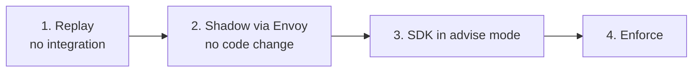

# Getting started

**Fastest path**: `npm run init` — the wizard asks your segment
(lender/PA/PSP/crypto) and signing tier, then writes a complete shadow
stack (`payrekha.json` with kit thresholds + your Ed25519 issuer keys,
docker-compose with Envoy + Prometheus, `.env` secrets, calendar,
README-NEXT). `docker compose --env-file .env up -d` and you're observing.
Or follow the four stages below manually.

Four steps, each safer than the next one and each reversible. Most teams spend a week or two on steps 1 and 2.



## 1. Replay last month's payouts (no integration)

Export payouts from your ledger as CSV or JSON. The columns are mapped with `--map`. Without `--intents`, PayRekha runs in **intent-less mode**: the behaviour, environment and settlement rules still run, and the intent rules are switched off.

```bash
npm ci
npm run replay -- --payouts ledger.csv --map map.json --out out/
# out/report.html (one self-contained file) and out/report.json
```

`map.json` maps PayRekha fields to your columns:

```json
{
  "payoutId": "txn_ref",
  "kind": "product",
  "amountRupees": "amount",
  "timestamp": "created_at",
  "account": "bene_acct",
  "ifsc": "bene_ifsc",
  "sourceKeyId": "api_client"
}
```

Bare timestamps such as `2026-10-12 02:10:00` are read as IST. Amounts in rupees with up to two decimals are converted to paise exactly. Each run hashes the beneficiaries with a throwaway key, so the report never shows a raw account number.

Read the **false-positive review list** first. It shows the single-rule REVIEWs you would hold, which is what you need to tune before going further.

Try it on the synthetic month first. It holds 3,280 NBFC payouts with three planted attacks:

```bash
npm run replay -- --payouts examples/data/payouts.csv --intents examples/data/intents.csv --config examples/data/payrekha.json
```

## 2. Shadow behind Envoy (no code change)

Put Envoy's `ext_authz` filter in front of your payout API and point it at PayRekha. In `shadow` (the default), PayRekha always answers 200 and the payout goes through unchanged. Every verdict it _would_ have given is logged. See [integrations/envoy.md](integrations/envoy.md).

```bash
docker compose -f deploy/docker-compose.yml up --build
```

Ship `decisions.jsonl` to your SIEM ([siem.md](integrations/siem.md)) and watch it for a week.

## 3. Sign intents and call the SDK in advise mode

Have your system of record (LOS, reconciliation engine, withdrawal approver) sign intents, as described in [intents.md](intents.md). Then call `/v1/evaluate` from your payout service with the [Java](integrations/java-spring.md), [Python](integrations/python.md), [Go](integrations/go.md) or [Node](integrations/node.md) client. In `advise` mode the caller sees the verdict and decides what to do with it.

## 4. Enforce, one payout kind at a time

```json
{ "mode": "shadow", "modeByKind": { "LOAN_DISBURSAL": "enforce" } }
```

Start with the kind that has the cleanest intents, usually loan disbursal. Keep the client fail mode at `hold-above:5000000` (hold anything above ₹50,000 if PayRekha is unreachable). Read [operations.md](operations.md) before you do this.
